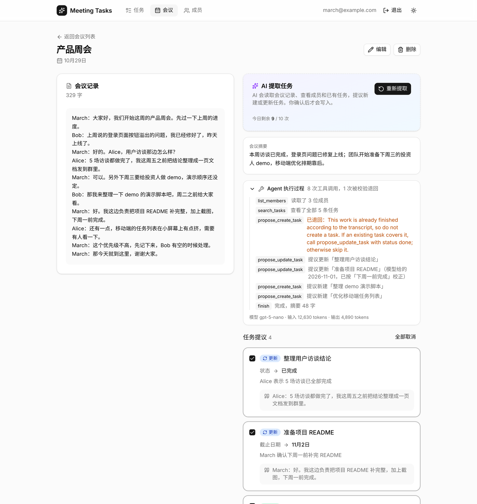
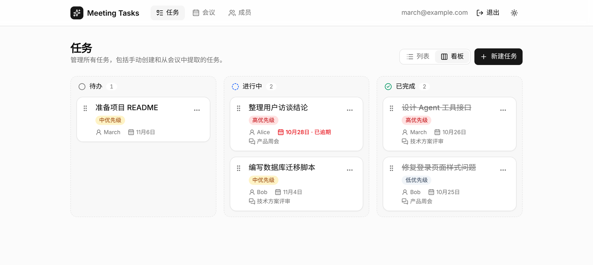
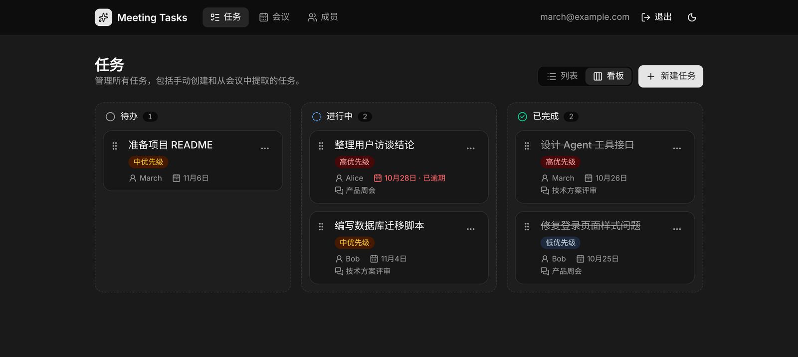
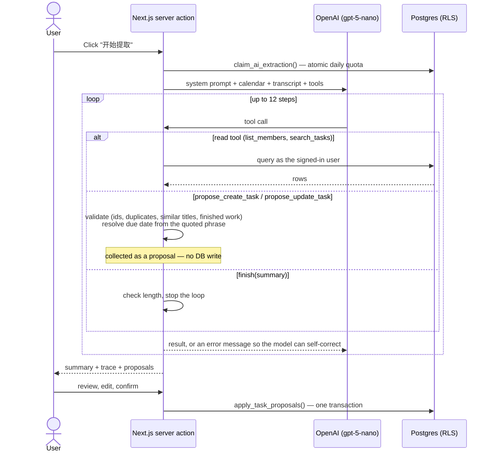
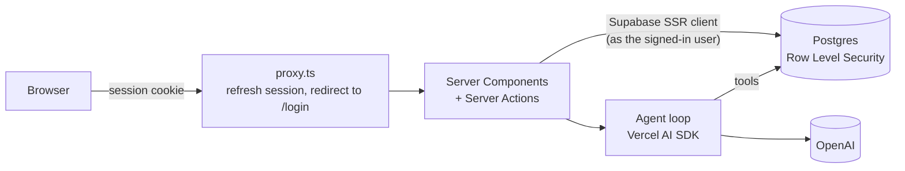

# Meeting Tasks

> Turn meeting notes into actionable tasks with an AI agent — with a human in the loop.

[中文](README.md) | **English**

**Live demo:** https://meeting-task.vercel.app — sign up with any email (each account has its own data and 10 AI extractions per day).

[](https://github.com/MARCHTOWNE/Meeting-Task/actions/workflows/ci.yml)


Paste a meeting transcript. An AI agent reads it, looks up your team members and existing tasks, then **proposes** new tasks or changes to existing ones — for example marking a task as done when someone says *"I fixed it yesterday"*. Every proposal shows the sentence it came from, and **nothing is written until you review and confirm it**.



## Features

- **AI task extraction** — a tool-calling agent proposes new tasks and updates to existing ones, each with the source quote from the transcript. The full execution trace (tool calls, rejected calls, corrected dates, token usage) is shown in the UI
- **Human review** — tick, untick or edit each proposal (title, owner, due date, priority), then apply them all in one transaction; the meeting summary is saved with the meeting
- **Tasks** — list and **Kanban board** views; drag cards between columns with the mouse *or keyboard*, with optimistic updates; create, edit, delete; overdue highlighting; link back to the source meeting
- **Meetings** and **Members** — full CRUD; members show their todo / in-progress / done workload
- **Accounts** — sign up / sign in with Supabase Auth; every user only sees their own data
- **Daily AI quota** — 10 extractions per account per 24 hours (configurable), so open sign-up cannot run up the OpenAI bill
- Dark mode, responsive layout, accessible components

| Kanban board | Dark mode |
| --- | --- |
|  |  |

## How the agent works



**Division of labour between the model and code.** The model is good at *understanding* the conversation; code is better at *rules and arithmetic*. So the model identifies action items, owners and the deadline phrase (e.g. "下周一前"), while code:

- **computes due dates** from that phrase relative to the meeting date (small models are often off by a day),
- **rejects finished work** — the model must label each item `not_started / in_progress / done`, and `done` items cannot become new tasks,
- **blocks duplicates** — exact titles and similar titles (character-bigram Dice similarity ≥ 0.6) are bounced back with a hint to update the existing task instead,
- **validates ids and dates** and returns errors to the model rather than throwing, so it fixes the call in the next step.

## Architecture



## Tech stack

| Layer | Choice |
| --- | --- |
| Framework | [Next.js 16](https://nextjs.org) — App Router, Server Components, Server Actions, Cache Components, `proxy.ts` |
| Language | TypeScript, Zod for validation |
| Database & auth | [Supabase](https://supabase.com) — Postgres, Row Level Security, Auth |
| UI | [shadcn/ui](https://ui.shadcn.com) + Radix UI, Tailwind CSS v4, Lucide icons, dnd-kit |
| AI | [Vercel AI SDK](https://ai-sdk.dev) tool calling + OpenAI `gpt-5-nano` |
| Testing | Vitest with a scripted mock language model; SQL tested on PGlite |
| CI / CD | GitHub Actions (lint, type-check, tests, build) → Vercel |

## Design decisions

**Security**

- **Row Level Security per user.** Every table has a `user_id` and an owner-only RLS policy. The server queries Postgres *as the signed-in user* (Supabase SSR client + session cookie), never with an admin key — a missing filter in app code still cannot leak another user's data. The agent's tools and the database functions run under the same policies.
- **Same-account foreign keys.** Foreign keys ignore RLS, so tasks reference members and meetings through composite keys `(id, user_id)`; a task can never point at another account's member.
- **Auth checks in layers.** `proxy.ts` refreshes the session and redirects signed-out visitors (fast check); the database enforces access (real check). Sessions are verified with `getClaims()` (JWT signature). The post-login `?next=` redirect only accepts relative paths, preventing open redirects.
- **Prompt-injection containment.** The transcript is passed as data and the agent can only *propose* writes, so instructions hidden in a transcript cannot change data without a human confirming them.

**Reliability and cost**

- **Atomic writes.** Confirmed proposals are applied by a Postgres function (`apply_task_proposals`) in a single transaction — if one update fails, nothing is written. Input is validated with Zod in the server action and again by foreign keys and check constraints.
- **Race-free quota.** `claim_ai_extraction()` checks and records usage under a per-user advisory lock, so parallel clicks cannot slip past the limit. Usage rows are insert-only for users, so a quota cannot be reset from the client, and a use is claimed *before* calling the model.
- **Cheapest viable model.** `gpt-5-nano` with low reasoning effort; a full extraction costs about $0.002. The loop is capped at 12 steps and the summary is length-checked. Override with `OPENAI_MODEL`.
- **Traceability.** Each extracted task stores its `source_quote`, so AI output can always be checked against the transcript.

**Testability**

- Agent data access sits behind an `AgentDataSource` interface, and tests replay scripted tool calls through a mock language model — the agent loop, validation, self-correction and date resolution are tested deterministically with **no API calls in CI**.
- Database migrations were tested against real Postgres (PGlite) with two simulated users: isolation, cross-account foreign keys, rollback on failure and quota limits.

## Testing

```bash
npm test          # 36 unit tests (agent loop, validation, dates, payload mapping, safe redirect)
npm run lint
npm run typecheck
npm run build
```

All four run in GitHub Actions on every pull request. Every change in this repository went through a PR — see the [closed pull requests](https://github.com/MARCHTOWNE/Meeting-Task/pulls?q=is%3Apr+is%3Aclosed) for the development history.

## Getting started

**Prerequisites:** Node.js 20+, a Supabase project, an OpenAI API key.

```bash
git clone https://github.com/MARCHTOWNE/Meeting-Task.git
cd Meeting-Task
npm install
cp .env.example .env.local   # fill in your keys
npm run dev
```

Set up the database in the Supabase dashboard:

1. **SQL Editor** → run [`supabase/schema.sql`](supabase/schema.sql) — tables, sample members
2. **SQL Editor** → run [`supabase/migrations/002_apply_task_proposals.sql`](supabase/migrations/002_apply_task_proposals.sql) — transactional "apply proposals" function
3. **Authentication → Users → Add user** → create your own account (tick *Auto Confirm User*); existing rows will be assigned to it
4. **SQL Editor** → run [`supabase/migrations/003_auth_and_rls.sql`](supabase/migrations/003_auth_and_rls.sql) — per-user ownership and RLS policies
5. **SQL Editor** → run [`supabase/migrations/004_ai_daily_quota.sql`](supabase/migrations/004_ai_daily_quota.sql) — daily AI quota
6. *(Optional)* **Authentication → Sign In / Providers → Email** → turn off *Confirm email* so new users can sign in right after signing up

Open http://localhost:3000 and sign up or sign in.

### Deploy

Import the repository in Vercel and set `NEXT_PUBLIC_SUPABASE_URL`, `NEXT_PUBLIC_SUPABASE_PUBLISHABLE_KEY` and `OPENAI_API_KEY` (optionally `OPENAI_MODEL`, `AI_DAILY_LIMIT`). In Supabase → **Authentication → URL Configuration**, set the Site URL to your Vercel domain and add `https://<your-domain>/auth/callback` to the redirect URLs.

## Project structure

```
app/
  login/ signup/      Sign-in and sign-up pages
  auth/               Auth server actions + email confirmation callback
  tasks/              Task list & Kanban board + server actions
  meetings/           Meetings CRUD, detail page, agent server actions
  members/            Members with workload stats + server actions
components/
  ui/                 shadcn/ui components
  tasks/ meetings/ members/ auth/
lib/
  agent/              Prompt, tools, agent loop, date resolution, quota, tests
  supabase/           SSR client that runs as the signed-in user
  auth/               Safe post-login redirect
proxy.ts              Session refresh + redirect to /login
supabase/             Schema and migrations
```

## Roadmap

- [x] Tasks, meetings and members CRUD
- [x] AI agent that proposes tasks from transcripts
- [x] Human review and transactional apply
- [x] Kanban board with drag & drop
- [x] Supabase Auth, per-user data, daily AI quota
- [x] Deployed on Vercel
- [ ] Evaluation set: score extraction accuracy across sample transcripts and models
- [ ] Audio upload with speech-to-text
- [ ] Due-date reminders by email
- [ ] Shared team workspaces

## License

[MIT](LICENSE)
