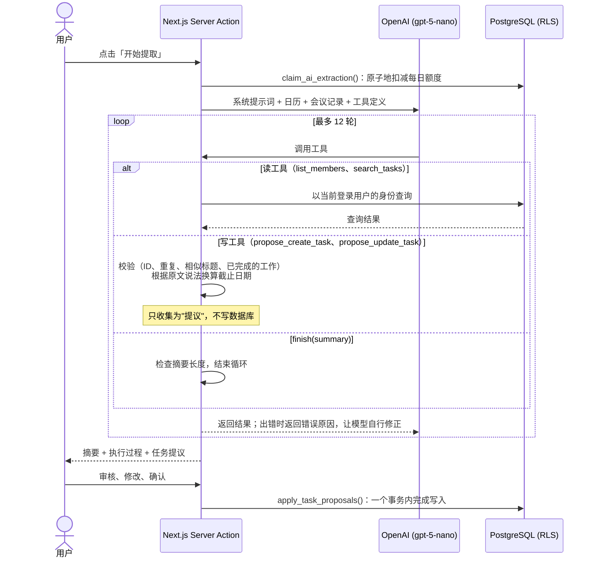
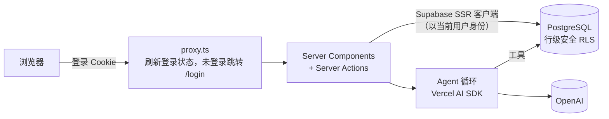

# Meeting Tasks · 会议纪要转任务

> 用 AI Agent 把会议记录自动变成可执行的任务，并由人来做最后确认。

**中文** | [English](README.en.md)

**在线体验：** https://meeting-task.vercel.app （用邮箱注册并输入验证码即可。每个账号的数据相互隔离，每天可以使用 10 次 AI 提取）

[](https://github.com/MARCHTOWNE/Meeting-Task/actions/workflows/ci.yml)


把会议记录粘贴进来，AI Agent 会阅读内容，查询团队成员和已有任务，然后**提议**新建任务或更新已有任务。例如有人说"那个问题我昨天已经修好了"，它会提议把对应的任务标记为已完成。每条提议都附有它在会议原文中的出处，**只有经过你确认，才会写入数据库**。


## 功能

- **AI 提取任务**：基于工具调用（Tool Calling）的 Agent 会提议新建任务或更新已有任务，每条提议都附带会议原文出处。页面会完整展示 Agent 的执行过程，包括调用了哪些工具、哪些调用被退回、哪些日期被校正，以及 token 用量。
- **人工确认**：可以勾选、取消或修改每条提议（标题、负责人、截止日期、优先级），确认后在**一个事务**里统一写入。会议摘要也会一并保存。
- **任务管理**：支持列表和**看板**两种视图。看板可以用鼠标或**键盘**拖动卡片，并且有乐观更新。任务可以新建、编辑和删除，逾期的任务会高亮显示，从会议中提取的任务可以跳回来源会议。
- **会议和成员管理**：完整的增删改查。成员卡片会显示每个人手上待办、进行中、已完成的任务数量。
- **账号系统**：基于 Supabase Auth 的注册和登录，注册时需要输入邮箱收到的 6 位验证码，每个用户只能看到自己的数据。
- **每日 AI 额度**：每个账号每 24 小时最多提取 10 次（次数可以配置），开放注册也不会让 OpenAI 费用失控。
- 支持深色模式和响应式布局，组件符合无障碍规范。

| 看板视图 | 深色模式 |
| --- | --- |
|  |  |

## Agent 的工作流程



**模型和代码各做擅长的事。** 模型擅长**理解**对话，代码擅长**执行规则和计算**。所以模型负责识别待办事项、负责人，以及截止日期的说法（比如"下周一前"），代码负责以下几件事：

- **计算截止日期**：根据原文说法和会议日期换算出具体日期。小模型算日期经常差一天，这一步交给代码更可靠。
- **拦截已完成的工作**：模型必须给每个事项标注状态（`not_started` / `in_progress` / `done`），标为 `done` 的事项不允许新建为任务。
- **防止重复**：标题完全相同、或者相似度超过 0.6（按字符二元组的 Dice 系数计算）的任务会被退回，并提示模型改为更新已有任务。
- **校验 ID 和日期**：出错时不抛异常，而是把错误原因返回给模型，让它在下一轮修正。

## 系统架构



## 技术栈

| 层 | 选型 |
| --- | --- |
| 框架 | [Next.js 16](https://nextjs.org)：App Router、Server Components、Server Actions、Cache Components、`proxy.ts` |
| 语言 | TypeScript，用 Zod 做数据校验 |
| 数据库与认证 | [Supabase](https://supabase.com)：PostgreSQL、行级安全（RLS）、Auth |
| 界面 | [shadcn/ui](https://ui.shadcn.com) + Radix UI、Tailwind CSS v4、Lucide 图标、dnd-kit |
| AI | [Vercel AI SDK](https://ai-sdk.dev) 工具调用 + OpenAI `gpt-5-nano` |
| 测试 | Vitest，用脚本化的模拟大模型测试 Agent；SQL 在 PGlite 上测试 |
| CI / CD | GitHub Actions（lint、类型检查、测试、构建）→ 自动部署到 Vercel |

## 设计决策

**安全**

- **按用户隔离的行级安全（RLS）**：每张表都有 `user_id` 字段和"只能访问自己数据"的 RLS 策略。服务端**以当前登录用户的身份**访问数据库（Supabase SSR 客户端 + 登录 Cookie），从不使用管理员密钥。即使应用代码里漏写了过滤条件，也不会泄露别人的数据。Agent 的工具和数据库函数同样受这些策略约束。
- **同账号外键**：外键约束不受 RLS 限制，所以任务通过 `(id, user_id)` 组合外键引用成员和会议，从数据库层面保证任务不可能引用其他账号的成员。
- **分层的权限检查**：`proxy.ts` 负责刷新登录状态，并拦截未登录的访问（快速检查）；数据库负责真正的访问控制。登录状态用 `getClaims()` 校验 JWT 签名。登录后的 `?next=` 跳转只接受站内相对路径，防止开放重定向攻击。
- **限制提示词注入的影响**：会议记录只作为数据传给模型，而 Agent 只能"提议"写入。即使会议记录里藏了恶意指令，没有人工确认也改不了任何数据。

**可靠性与成本**

- **原子写入**：确认后的提议由数据库函数 `apply_task_proposals` 在同一个事务里写入，任何一条失败，整批都不会写入。数据先在 Server Action 里用 Zod 校验一次，再由外键和 check 约束兜底。
- **不会被并发绕过的额度限制**：`claim_ai_extraction()` 在每个用户的 advisory lock 保护下完成"检查 + 记录"，同时点击多次也不会超额。使用记录对用户来说只能新增、不能修改或删除，无法从客户端重置额度。调用模型**之前**就先扣减额度，失败的调用也会计入。
- **选用够用且最便宜的模型**：`gpt-5-nano` 加低推理强度，一次完整提取约 0.002 美元。Agent 循环最多 12 轮，摘要长度也有校验。可以通过 `OPENAI_MODEL` 更换模型。
- **可追溯**：每个由 AI 提取的任务都保存了它在会议原文中的出处（`source_quote`），随时可以核对 AI 的输出。

**可测试性**

- Agent 的数据访问通过 `AgentDataSource` 接口隔离，测试时用模拟大模型按脚本回放工具调用。Agent 循环、参数校验、自我修正和日期换算都可以稳定地测试，**CI 中不调用任何真实 API**。
- 数据库迁移在真实的 PostgreSQL（PGlite）上测试过，模拟了两个用户，覆盖了数据隔离、跨账号外键、失败回滚和额度限制。

## 测试

```bash
npm test          # 36 个单元测试（Agent 循环、校验、日期换算、数据转换、安全跳转）
npm run lint
npm run typecheck
npm run build
```

每个 Pull Request 都会在 GitHub Actions 上自动运行以上四项。本仓库的所有改动都是通过 PR 合并的，完整的开发过程见[已关闭的 Pull Requests](https://github.com/MARCHTOWNE/Meeting-Task/pulls?q=is%3Apr+is%3Aclosed)。

## 本地运行

**准备：** Node.js 20+、一个 Supabase 项目、一个 OpenAI API key。

```bash
git clone https://github.com/MARCHTOWNE/Meeting-Task.git
cd Meeting-Task
npm install
cp .env.example .env.local   # 填入你自己的 key
npm run dev
```

在 Supabase 后台初始化数据库，按顺序操作：

1. **SQL Editor** → 运行 [`supabase/schema.sql`](supabase/schema.sql)：建表，并插入示例成员
2. **SQL Editor** → 运行 [`supabase/migrations/002_apply_task_proposals.sql`](supabase/migrations/002_apply_task_proposals.sql)：创建事务性的"确认写入"函数
3. **Authentication → Users → Add user** → 创建你自己的账号，勾选 *Auto Confirm User*。已有的数据会归到这个账号下
4. **SQL Editor** → 运行 [`supabase/migrations/003_auth_and_rls.sql`](supabase/migrations/003_auth_and_rls.sql)：按用户隔离数据，并启用 RLS 策略
5. **SQL Editor** → 运行 [`supabase/migrations/004_ai_daily_quota.sql`](supabase/migrations/004_ai_daily_quota.sql)：创建每日 AI 额度
6. **配置邮箱验证**（注册时发送 6 位验证码）：
   - **Authentication → Emails → SMTP Settings**：开启自定义 SMTP。Supabase 自带的邮件服务只能发给项目成员，每小时 2 封，不能用于真实用户。可以使用 QQ 邮箱（`smtp.qq.com`，端口 465，密码填邮箱设置里生成的授权码）或其他 SMTP 服务
   - **Authentication → Emails → Templates → Confirm sign up**：使用 [`supabase/email-templates/confirm-signup.html`](supabase/email-templates/confirm-signup.html)，邮件里显示 `{{ .Token }}` 验证码
   - **Authentication → Sign In / Providers → Email**：开启 *Confirm email*

然后打开 http://localhost:3000 注册或登录。

### 部署

在 Vercel 导入本仓库，配置环境变量 `NEXT_PUBLIC_SUPABASE_URL`、`NEXT_PUBLIC_SUPABASE_PUBLISHABLE_KEY`、`OPENAI_API_KEY`（可选：`OPENAI_MODEL`、`AI_DAILY_LIMIT`）。再到 Supabase → **Authentication → URL Configuration**，把 Site URL 设为你的 Vercel 域名，并在 Redirect URLs 中加入 `https://<你的域名>/auth/callback`。

## 目录结构

```
app/
  login/ signup/ verify/   登录、注册、邮箱验证页面
  auth/               认证相关的 Server Actions，以及邮件确认回调
  tasks/              任务列表与看板 + Server Actions
  meetings/           会议增删改查、详情页、Agent 相关的 Server Actions
  members/            成员管理与工作量统计 + Server Actions
components/
  ui/                 shadcn/ui 组件
  tasks/ meetings/ members/ auth/
lib/
  agent/              提示词、工具、Agent 循环、日期换算、额度、测试
  supabase/           以当前用户身份访问数据库的 SSR 客户端
  auth/               登录后的安全跳转
proxy.ts              刷新登录状态，未登录跳转到 /login
supabase/             数据库结构和迁移脚本
```

## 路线图

- [x] 任务、会议、成员的增删改查
- [x] AI Agent 从会议记录中提议任务
- [x] 人工确认，事务性写入
- [x] 看板与拖拽
- [x] Supabase Auth、按用户隔离数据、每日 AI 额度
- [x] 部署到 Vercel
- [ ] 评估集：用一批样例会议记录为提取准确率打分，并对比不同模型
- [ ] 上传音频并自动转写
- [ ] 截止日期邮件提醒
- [ ] 团队共享工作区

## 许可证

[MIT](LICENSE)
